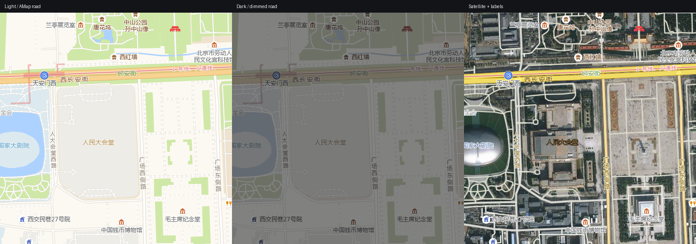

# Immich 换高德地图 + 中文地名（电脑 / 手机）

给 [Immich](https://immich.app/) 换上高德底图，让照片标记对准地物，并让地点显示成中文。
**电脑和手机都支持**，按下面一条路径部署即可。



## 相关项目

| 项目 | 作用 |
| --- | --- |
| **本仓库** `immich-amap` | 高德底图样式 + GCJ-02 纠偏 + 中文地名库 + 通用 Docker 部署 |
| [whxciotw/immich-app](https://github.com/whxciotw/immich-app) | 非官方 Android 构建：修复 Places 地图初始位置，地点页三级折叠，App 内更新 |
| [whxciotw/immich](https://github.com/whxciotw/immich) | 两个项目的门户/文档索引 |

配套关系：本仓库提供地图样式与纠偏服务，Immich 客户端（Web 或上述 Android 构建）
通过样式 URL 使用；手机端黑屏与初始位置的 App 侧修复见
[whxciotw/immich-app](https://github.com/whxciotw/immich-app)。

部署完成后你会得到：

- 高德亮色 / 暗色 / 卫星三种底图，电脑和 Immich App 都能用；
- 照片位置不再整体偏移（高德 GCJ-02 与照片 WGS-84 对齐）；
- 地点名变成中文城市名（如 `杭州市`），不再显示英文或村镇名。

## 需要部署的三个组件

| 组件 | 作用 | 为什么必须有 |
| --- | --- | --- |
| `tile-proxy` | 把高德 GCJ-02 瓦片重采样到 WGS-84 网格 | 不做的话照片标记整体偏几百米 |
| `mapstyle`（nginx） | 通过 http 提供样式 URL | 手机 App 只认 http(s) 地址 |
| geodata（数据目录） | 替换 Immich 内置的 GeoNames 地名库 | 否则地点是英文 / 村镇名 |

## 前提条件

| 项 | 要求 |
| --- | --- |
| 主机 | 任意 Linux / NAS / 云主机，能装 Docker 和 Docker Compose |
| Python | 3.9+（只在生成样式/地名库时用，零运行时依赖） |
| Immich | v3.x（v3.3.x 实测） |
| 网络 | 主机能出网访问 `*.is.autonavi.com`；`9002`、`9003` 端口要对局域网开放 |
| 地址 | 准备一个局域网 IP 或域名，下文用 `<HOST>` 表示 |

> 9002/9003 是**浏览器**直接访问的，不是 Immich 服务端访问的；只绑 `127.0.0.1` 会打不开地图。

## 步骤 1：准备配置

```bash
git clone https://github.com/whxciotw/immich-amap.git && cd immich-amap
cp .env.example .env
$EDITOR .env
```

至少把 `HOST` 改成你自己的地址；其余默认值一般不用动：

| 变量 | 默认 | 用途 |
| --- | --- | --- |
| `HOST` | `192.0.2.10` | 生成样式时写进 URL |
| `TILE_PROXY_PORT` / `MAPSTYLE_PORT` | `9002` / `9003` | 宿主机端口 |
| `DATA_DIR` / `STYLE_DIR` | `./data` / `./dist/mapstyles` | 持久化目录 / 样式输出目录 |
| `TZ` | `Asia/Shanghai` | 容器时区 |

## 步骤 2：生成样式

```bash
set -a; . ./.env; set +a

python3 -m immich_amap static \
  --tile-base "http://$HOST:${TILE_PROXY_PORT:-9002}" \
  --public-base "http://$HOST:${MAPSTYLE_PORT:-9003}" \
  --center <经度>,<纬度> --zoom 15 \
  --out dist/mapstyles
```

`--center` 是地图初始中心（经度,纬度），`--zoom` 是初始缩放级别，按自己常看的位置改。

## 步骤 3：启动容器

```bash
docker compose up -d
docker compose ps          # tile-proxy、mapstyle 都应为 Up
```

验证：

```bash
curl -s http://$HOST:9002/health                        # {"ok":true,...}
curl -sI http://$HOST:9003/style-light.json | head -1   # 200
```

## 步骤 4：填进 Immich（电脑 + 手机）

**Immich → 管理 → 系统设置 → 地图与 GPS 设置 → 地图**：

```
亮色风格：http://<HOST>:9003/style-light.json
暗色风格：http://<HOST>:9003/style-dark.json
```

保存后刷新页面。如果地址栏还残留 `#15/31.17/121.61` 这类 hash，先访问一次干净的
`http://<HOST>:2283/map`，否则初始视野会被 hash 覆盖。

此时电脑和手机都应正常显示高德地图；手机 App 如果黑屏，通常是样式 URL 不是 http(s)
或者手机连不上 `<HOST>`。

## 步骤 5：部署中文地名库

Immich 的逆地理编码用镜像内 `/build/geodata` 的 GeoNames 数据，需要替换成中文版。

### 5.1 从 Immich 镜像原始层取数据

> 注意：不要 `docker cp immich_server:/build/geodata`——挂载 volume 后那里已经是旧的中文库。
> 用临时容器从镜像里取。

```bash
# 镜像 tag 换成你实际使用的 Immich 版本（示例为 v3）
docker create --name immich-geodata-src ghcr.io/immich-app/immich-server:v3
docker cp immich-geodata-src:/build/geodata /tmp/geodata-orig
docker rm immich-geodata-src
```

### 5.2 生成中文地名库

```bash
python3 -m immich_amap geodata --src /tmp/geodata-orig --dst /tmp/geodata-cn --prefix none
```

- 上面命令显示纯市名（如 `杭州市`）；想要「省 · 市」（如 `浙江 · 杭州市`）去掉 `--prefix none`；
- 想要区县粒度加 `--level county`；
- 想用高德官方行政区名精修、或补更多地名点，见 [docs/geodata-cn.md](docs/geodata-cn.md)。

### 5.3 挂进 Immich

把生成好的目录放到持久化位置（例如 `./data/geodata-cn`），然后在 `immich-server` 的
compose 配置里追加一行只读 volume：

```yaml
    immich-server:
      volumes:
        - ${UPLOAD_LOCATION}:/usr/src/app/upload
        - /path/to/geodata-cn:/build/geodata:ro      # <== 追加
```

然后重启 `immich-server`，日志里应出现：

```
Successfully imported 229133 geodata records in 7.98s
Initialized local reverse geocoder
```

### 5.4 刷新已有照片

**管理 → 任务 → 提取元数据 → 全部运行**（或 API 触发 `metadataExtraction`）。
不跑这一步，已有照片的旧地名不会更新；以后新导入的照片会自动使用新地名。

## 验收清单

| # | 检查 | 期望 |
| --- | --- | --- |
| 1 | `curl -s http://<HOST>:9002/health` | `{"ok":true,...}` |
| 2 | `curl -sI http://<HOST>:9003/style-light.json` | `200` |
| 3 | 电脑浏览器打开 Immich 地图 | 高德底图，标记对准地物 |
| 4 | 手机 App 打开地图 | 不黑屏，底图正常 |
| 5 | 资产详情里的地点 | 中文（如 `杭州市`） |
| 6 | 已存在资产 | 重跑元数据提取后变为中文 |

## 常见问题

**手机黑屏？** 样式 URL 必须是 `http(s)://`；确认手机能访问 `<HOST>:9003`。

**照片位置偏几百米？** 检查 Immich 里填的是 `style-light.json`（走 tile-proxy），
而不是直连高德；确认 `tile-proxy` 健康。

**地图空白 / 404？** 检查 `dist/mapstyles` 是否生成、`docker compose ps` 是否正常、
端口是否被占用。

**地点还是英文？** 检查 `immich-server` 是否挂载了 geodata、`geodata-date.txt` 是否更新、
是否重跑了「提取元数据」。

**放大很模糊？** 高德瓦片只到 z18，再放大是拉伸。

**https 访问 Immich 时地图空白？** 样式/瓦片是 http，被浏览器当混合内容拦了；
挂到同一个 https 反代下重新生成，见 [docs/deployment.md](docs/deployment.md)。

更多见 [docs/faq.md](docs/faq.md)。

## 更新与回滚

```bash
# 更新样式：重新执行步骤 2，刷新页面即可（nginx 设了 no-cache）
# 更新容器
docker compose pull && docker compose up -d
# 更新地名库：重复步骤 5.1–5.4
```

- 地名库回滚：把 volume 换回旧目录/去掉，重启并重跑元数据提取；
- 样式回滚：重新生成旧参数即可，无状态。

## 文档

| 文档 | 内容 |
| --- | --- |
| [docs/deployment.md](docs/deployment.md) | 通用 Docker 部署细节、HTTPS/CORS、回滚 |
| [docs/operations.md](docs/operations.md) | 日常运维与排障 |
| [docs/geodata-cn.md](docs/geodata-cn.md) | 地名库规则、粒度、高德精修 |
| [docs/architecture.md](docs/architecture.md) | 为什么会偏、纠偏原理 |
| [docs/mobile.md](docs/mobile.md) | 手机端相关限制 |
| [docs/faq.md](docs/faq.md) | 常见问题 |

## 开发与测试

```bash
make test        # 单元测试
make lint        # ruff
make selftest    # 实抓一张瓦片验证（需 tile-proxy 在跑）
```

## 致谢

- [Immich](https://immich.app/)：自建照片管理，本项目的宿主；
- [NEGIAO/tile-proxy](https://github.com/NEGIAO/tile-proxy)：GCJ-02 逐瓦片纠偏服务；
- [938134/ha_cnmaps](https://github.com/938134/ha_cnmaps)：早期同思路实现，本方案的灵感来源；
- [GeoNames](https://www.geonames.org/) / [Natural Earth](https://www.naturalearthdata.com/)：地名数据；
- 所有试用、反馈、提 issue 的人。

## 限制与许可

- 本仓库代码采用 [MIT License](LICENSE)；
- 高德瓦片地址是社区直连方式，**不是高德官方授权接口**，个人自用风险自负；
  商用请走[高德开放平台](https://lbs.amap.com/)正规授权；
- 高德瓦片最大 z18；暗色样式是滤镜压暗（高德没有暗色栅格瓦片）；
- 中文地名覆盖率受 GeoNames 中文别名限制（全球约 20%，中国城市约 94%），
  可用 `--alternate-names` / `--amap-cache` 提升；
- `tile-proxy` 使用上游镜像 [NEGIAO/tile-proxy](https://github.com/NEGIAO/tile-proxy)
  （GPL-2.0-or-later）；手机端修复对应的 Immich 补丁按 AGPL-3.0 保留在
  [whxciotw/immich-app](https://github.com/whxciotw/immich-app) 仓库中。
